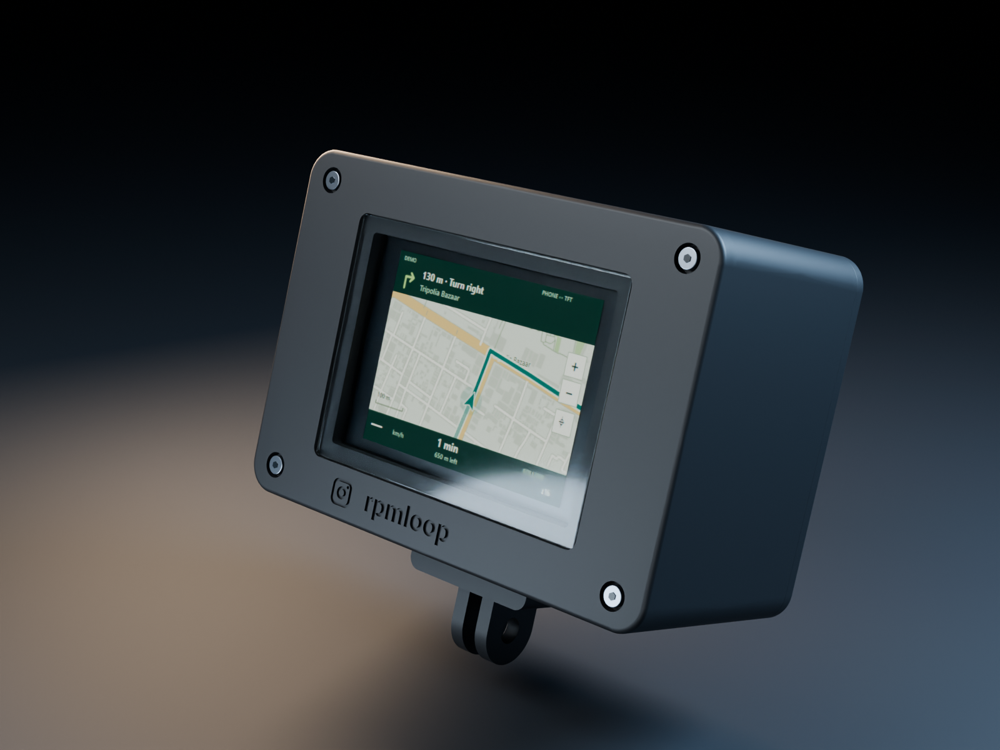
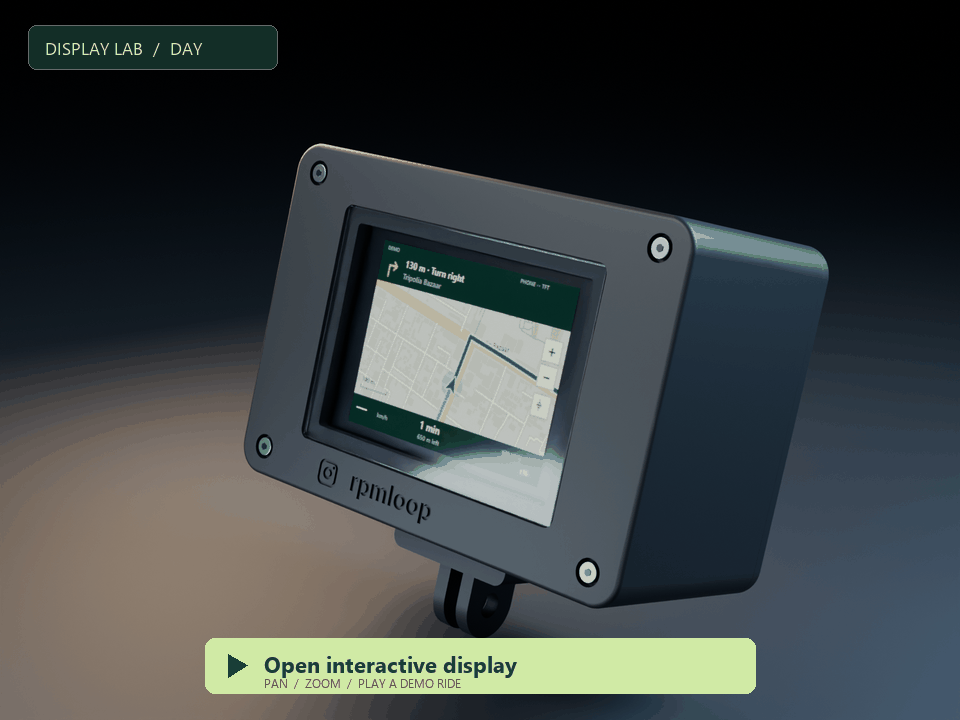
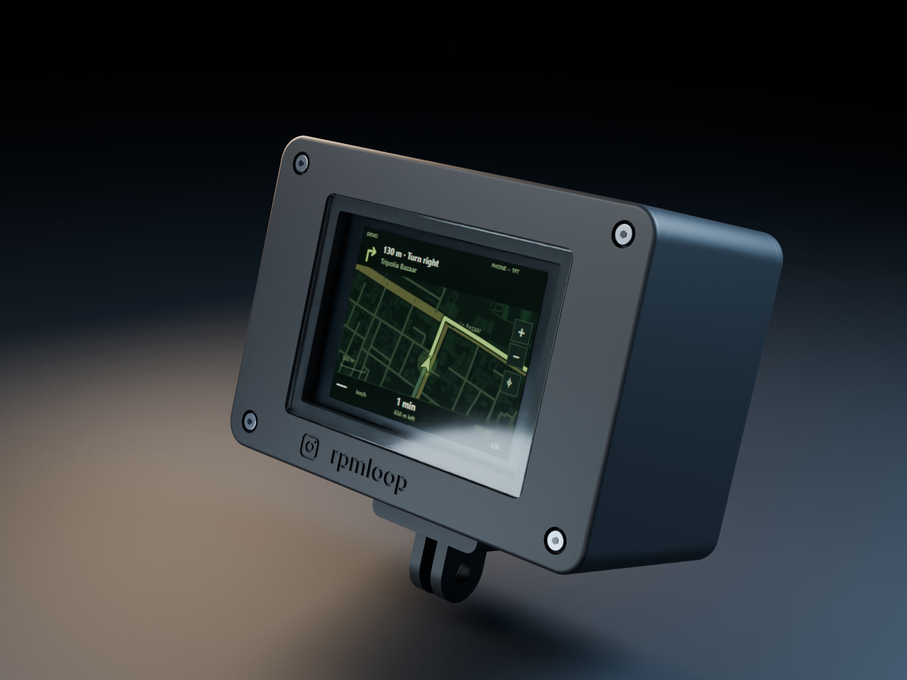
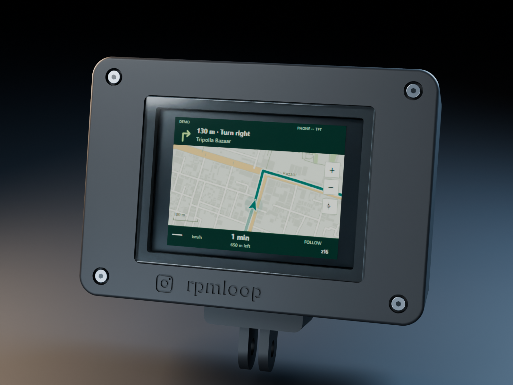
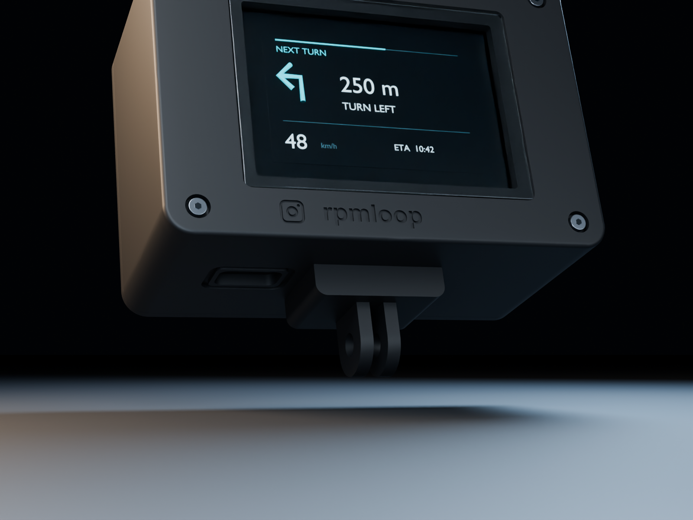
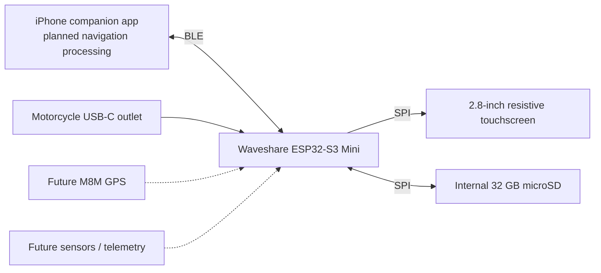
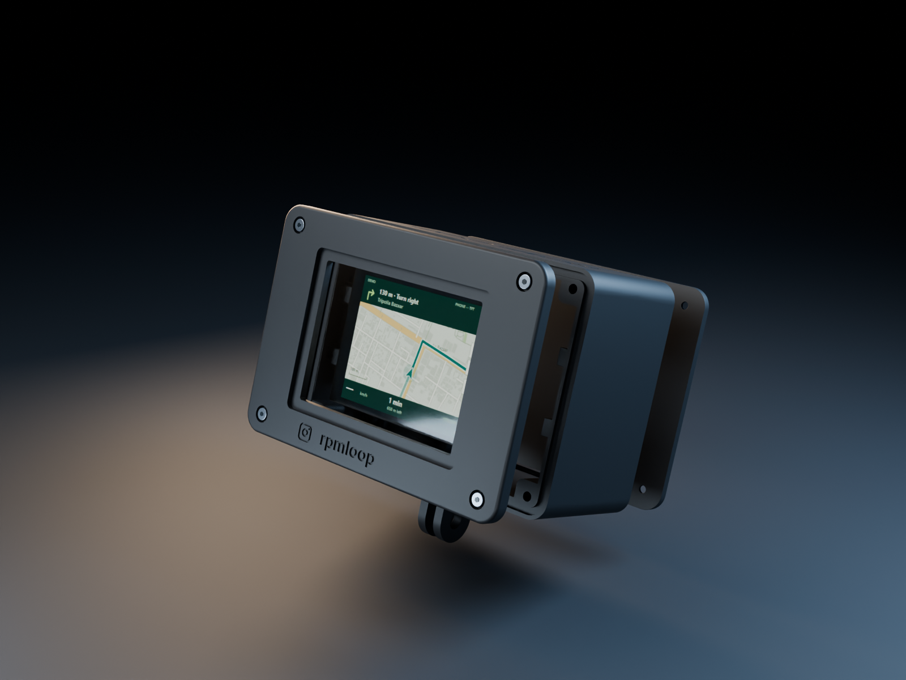
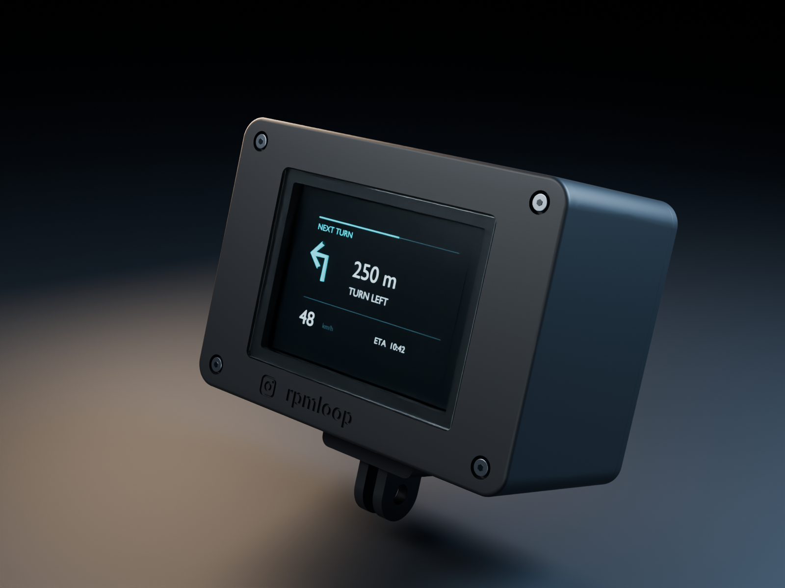
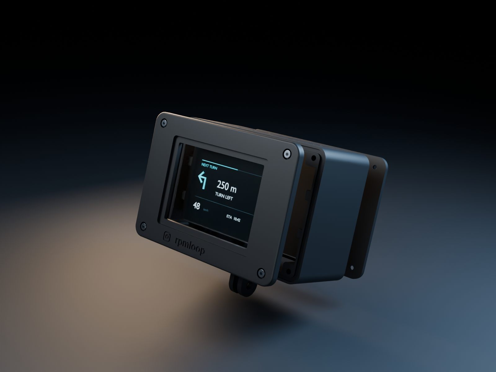

# RPMLOOP Navigator

### Your next turn. Your own hardware.

An open-source motorcycle navigation dashboard, designed around the Royal Enfield Hunter 350.

**A compact instrument for the ride ahead.**

[Try the display](https://shinchan1907.github.io/rpmloop-navigator/preview/) · [Printing files](printing_files/) · [Build and material guide](printing_files/README.md) · [Hardware status](#build-status) · [Contributing](CONTRIBUTING.md)

RPMLOOP Navigator brings a dedicated navigation display to the motorcycle cockpit. The vision is simple: the iPhone handles navigation processing, an ESP32-S3 renders the information that matters, and a purpose-built enclosure keeps the hardware compact, serviceable and expandable.

This repository starts with the **P3 enclosure design, individual manufacturing files and engineering notes**. Firmware and the iPhone companion app will be added here as development continues.

> **Design visualization, not a product photograph.** The renders use the current CAD enclosure with illustrative screen UI, window and hardware. They do not demonstrate running firmware, proven touch compatibility, waterproofing or road qualification.

## Try the interactive display

**[Open the interactive HTML mockup →](https://shinchan1907.github.io/rpmloop-navigator/preview/)**

Pan with your mouse, zoom in/out, play or scrub a demo ride, jump between turns,
switch day/night, and try both **320 × 240 landscape** and **240 × 320 portrait**.
The case surrounds a native-resolution LCD canvas; its on-screen size can be enlarged.
The linked card opens the interactive page because GitHub READMEs cannot execute HTML/JavaScript widgets.

The demo uses real OpenStreetMap streets and a bundled road-following OSRM route
from Albert Hall Museum to Hawa Mahal in Jaipur. It works offline after downloading
the [`docs/preview/`](docs/preview/) folder: open `index.html` in Chrome or another browser.
There are no API keys or external tile requests. See the [controls and map credits](docs/preview/README.md).

**UI concept only.** A companion app could prepare a route and map tiles for the
ESP32-S3 to display with a route overlay and touch controls. This mockup explores
that appearance; it does not implement firmware, the companion app, GPS, BLE or
live routing, or demonstrate achievable frame rate, memory use or tile transfer speed.
The portrait case presentation does not revise the existing landscape enclosure CAD.

  
  

Map data and map-derived artwork: © [OpenStreetMap contributors](https://www.openstreetmap.org/copyright),
[ODbL 1.0](https://opendatacommons.org/licenses/odbl/1-0/). Route snapshot: OSRM driving profile;
Jaipur demo retrieved 27 October 2026. This is illustrative routing, not motorcycle guidance or live traffic.

## Designed around the ride

| Detail | Design intent |
|---|---|
| Dedicated display | 2.8-inch, 240 × 320 SPI resistive touchscreen |
| Bottom cable routing | USB-C access beside the bottom mount |
| Two-finger mount | Flat sides and an M5 through-hole; the mating accessory supplies the nut receiver |
| Matte-black enclosure | ASA print target, rounded corners and recessed branding |
| Serviceable construction | Separate bezel and rear lid, heat-set insert locations and removable PCB supports |
| Expandable interior | Reserved volumes for a future M8M GPS assembly and battery |
| Internal storage | A sealed-in microSD card, with no external card slot |

  

## The platform

Planned software includes supported turn instructions, distance to the next turn, dashboard data, touch controls, trip information and settings. Custom animations, map/zoom interaction where supported, telemetry logging and music controls are future development areas—not completed features in this release.

Power currently targets the motorcycle's existing USB-C outlet. A future battery requires a selected cell, protection/charging design and thermal validation. GPS, antenna, battery and sensor fit depend on the actual assemblies chosen.

## Built in separate, inspectable parts

The enclosure separates the outer housing, front bezel, rear lid, ESP32 cradle and display retaining tabs. Seal templates are supplied separately from the rigid print parts. The reinforced two-finger mounting interface is integral to the housing.

The body/bezel envelope is **100 × 70 × 49 mm, excluding the bottom mount**. Display PCB envelope, active LCD area, front viewing opening and protective-window dimensions remain separate definitions. **The 85 × 48 mm display PCB outline is not the screen opening.**

## Printing files

Start with **[printing_files/README.md](printing_files/README.md)**. It contains part quantities, materials, colour, wall and layer settings, infill, orientation, nominal thickness, hardware notes and the physical acceptance checklist.

| Folder | Contents |
|---|---|
| [`01_Rigid_STL`](printing_files/01_Rigid_STL/) | Housing, bezel, rear lid, ESP32 cradle, handed retaining tabs and insert coupon |
| [`02_Flexible_Prototype_STL`](printing_files/02_Flexible_Prototype_STL/) | Uncompressed gasket/washer templates and millimetre-scale SVG outlines |
| [`03_Images`](printing_files/03_Images/) | Individual part images and technical assembly views |
| [`04_CAD`](printing_files/04_CAD/) | Native SolidCraft assembly and STEP interchange files |
| [`05_Verification`](printing_files/05_Verification/) | Digital mesh and interference evidence |
| [`06_Source`](printing_files/06_Source/) | CAD generators and frozen command script |

**Eight rigid pieces form the enclosure assembly:** one housing, one bezel, one rear lid, one cradle and four retaining tabs. The insert coupon and flexible seal templates are additional items. Quantities are included in the STL filenames.

Print rigid parts in the specified ASA process. **Do not print silicone gasket shapes in ASA.** Silicone is the preferred final sealing material; TPU files are for fit prototypes. STL files use millimetres and are translated individually to a print-bed datum, without scaling.

## Build status

**Current release: P3 fit-test prototype.** The files are open for inspection, iteration and prototype fabrication. They are not a production-ready, waterproof or road-qualified product.

Completed digital work:

- Bottom USB-C opening and rotated ESP32 cradle.
- Two flat mounting fingers with no external nut collar.
- Front Instagram-style icon/`rpmloop` branding and large top `RPMLOOP` engraving.
- M2 insert locations, matching cover holes, gasket channels and PCB retaining supports.
- Closed STL mesh checks and rigid-part/component interference checks against the modelled references.

Required physical validation:

- Actual LCD active area, glass/touch border and module stack dimensions.
- Brass insert outside diameter and the correct ASA pilot size.
- Wired-board clearance, actual USB connector position and the chosen cable plug.
- Mating action-camera mount, fastener clearance and sustained mechanical loads.
- Gasket material/compression, live USB weather protection, rain, condensation, heat and vibration.

The current **10.5 × 4.2 mm USB opening is a clearance design, not a measured fit guarantee**. The board's 18 × 23.5 mm XY outline comes from the supplied reference; its thickness and connector Z position still need verification. Test the relevant interfaces before ordering a final enclosure set.

See the detailed [verification report](printing_files/05_Verification/validation.md), including numerical-contact and audit-limit notes. Digital checks do not replace physical tests.

## Development roadmap

- **Hardware:** verify display and connector interfaces; print fit samples; refine sealing and retention.
- **Firmware:** display bring-up, touch calibration, BLE protocol, UI rendering and asset storage.
- **iPhone app:** BLE transport and supported navigation-data delivery.
- **Expansion:** qualify GPS/antenna placement, battery power management, telemetry and logging.
- **Validation:** bench tests followed by controlled environmental and mechanical testing.

The [`firmware/`](firmware/) and [`companion_app/`](companion_app/) directories currently document intended scope. Source code will be published as it is implemented.

## Contribute

Build notes, measured hardware drawings, fit-test photos and reproducible issue reports are welcome. Include the design revision, exact module/cable/insert variant, print process and measurements. Please read [CONTRIBUTING.md](CONTRIBUTING.md) before proposing a change.

CAD and manufacturing changes should preserve the separation between verified measurements and placeholders. Do not promote a fit-test revision to a production release without supporting evidence.

## Rendering

The studio images were rendered from the CAD-derived print meshes in Blender. The
new map renders use native **320 × 240** day/night PNG exports from the HTML mockup.
The [map render script](rendering/render_map_product.py), [map studio scene](rendering/rpmloop_map_studio.blend)
and [LCD textures](rendering/map-ui/) are included for reproducibility. The screen
uses a 4:3 render-only active-area illustration; physical active LCD dimensions
remain subject to module measurement. Rendering does not modify manufacturing files.

The [original render script](rendering/render_product.py), [original studio scene](rendering/rpmloop_studio.blend)
and all original images remain available.

Original arrow-UI renders (preserved design history)

## License

Published under the [MIT License](LICENSE). Third-party components, tools and trademarks retain their respective ownership. Royal Enfield, Waveshare, ESP32, USB-C and Instagram references identify intended compatibility or components; this project is independent and is not an official product or endorsement from those brands.

---

  <strong>RPMLOOP Navigator</strong> 
  Open hardware. Built to evolve. 
  <a href="https://www.instagram.com/rpmloop/">@rpmloop</a>

