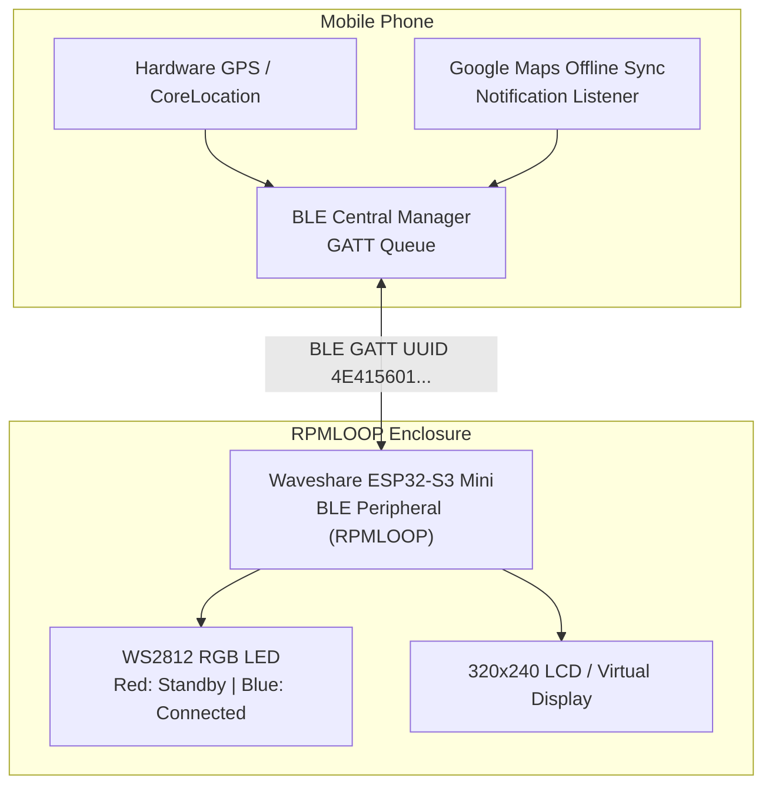

# RPMLOOP Navigator — Mobile Companion Apps

The RPMLOOP navigation ecosystem features full companion applications for both **Android** and **iOS** platforms. Both apps implement the same versioned protocol specification over Bluetooth Low Energy (BLE), allowing your smartphone to handle compute-intensive GPS tracking, routing, and geocoding while streaming lightweight navigation packets to the motorcycle display.

---

## 📱 Platform Comparison & Downloads

| Feature | Android App | iOS App |
|---|---|---|
| **Language** | Java (Native SDK) + WebKit | Swift (SwiftUI) |
| **Minimum OS** | Android 8.0 (Oreo) to Android 14+ | iOS 16.0+ |
| **Pre-built Package** | [**`RPMLoopNav.apk`**](android/RPMLoopNav.apk) *(66 KB)* | [**`RPMLoopNav_v2.ipa`**](ios/RPMLoopNav_v2.ipa) *(267 KB)* |
| **Install Method** | Direct APK install / Sideload | Sideloadly / AltStore / Xcode |
| **Google Maps Offline Sync** | ✅ Native Notification Interceptor | ⚠️ Background GPS Engine (OSRM) |
| **Offline Map Tile Cache** | ✅ IndexedDB CartoDB / OSM | ✅ In-memory vector tile cache |
| **Daylight Light Theme** | ✅ High-contrast daylight UI | ✅ Adaptive High-contrast SwiftUI |
| **Continuous GPS Telemetry**| ✅ 2s loop (`lat`, `lon`, speed) | ✅ CoreLocation Automotive stream |
| **Display Backlight Control**| ✅ Slider (0–100% PWM via BLE)| ✅ Slider (0–100% PWM via BLE) |
| **Source Code** | [`companion_app/android/`](android/) | [`companion_app/ios/`](ios/) |

---

## 🛰️ How the Phone Connects to ESP32

For platform-specific instructions, visit:
- 🤖 [Android Companion App Documentation](android/README.md)
- 🍎 [iOS Companion App Documentation](ios/README.md)
