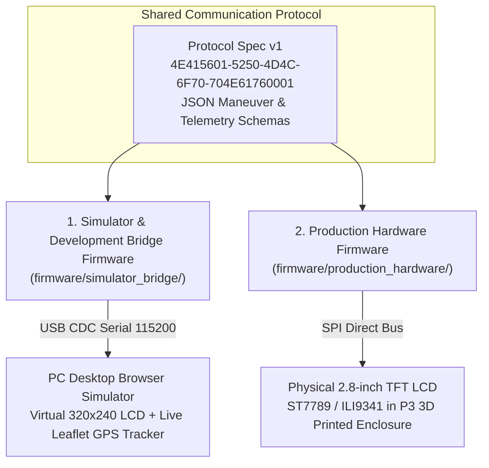

# RPMLOOP Navigator — ESP32-S3 Firmware Suite

The RPMLOOP navigation platform provides **two distinct, purpose-built firmware configurations** sharing the exact same BLE GATT protocol definition.

---

## ⚡ Firmware Configurations

---

### 1. [Simulator & Development Bridge Firmware](simulator_bridge/)
- **Use Case:** Bench development, rapid protocol testing, and running the desktop web simulator.
- **Hardware Output:** USB CDC Framed Serial (COBS + CRC-16) to PC bridge server (`bridge.py`).
- **Status LED:** Onboard WS2812 mini RGB LED (`SOLID RED` = Standby advertising `RPMLOOP`, `SOLID BLUE` = Phone BLE paired).
- **Directory:** [`firmware/simulator_bridge/`](simulator_bridge/)

### 2. [Production Hardware Firmware](production_hardware/)
- **Use Case:** Real-world motorcycle installation inside the 3D-printed enclosure.
- **Hardware Output:** Direct SPI signals to the physical 2.8" 320 × 240 TFT LCD with 5 kHz PWM backlight dimming, resistive touch (XPT2046), and internal MicroSD storage.
- **Status LED:** Onboard WS2812 mini RGB LED (`SOLID RED` = Disconnected, `SOLID BLUE` = Connected).
- **Directory:** [`firmware/production_hardware/`](production_hardware/)

---

## 📜 Communication Protocol

Both firmware variants implement the official RPMLOOP protocol specification documented in [`firmware/protocol/protocol_spec.md`](protocol/protocol_spec.md).

- **BLE Service UUID:** `4E415601-5250-4D4C-6F70-704E61760001`
- **Command/Nav Characteristic:** `4E415602-5250-4D4C-6F70-704E61760002` (Write / Write Without Response)
- **Status/ACK Characteristic:** `4E415603-5250-4D4C-6F70-704E61760003` (Notify / Read)
- **Device Info Characteristic:** `4E415604-5250-4D4C-6F70-704E61760004` (Read)

For detailed packet payloads, CRC verification, and test fixtures, see:
- 📖 [Protocol Specification & Test Fixtures](protocol/README.md)
