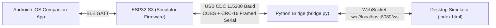

# RPMLOOP Navigator — Desktop Simulator & Bridge

The RPMLOOP Desktop Simulator allows developers, riders, and hardware designers to test the entire navigation experience directly in a web browser without needing physical SPI LCD wiring.

---

## 🖥️ System Architecture



---

## 🌟 Key Features of the Desktop Simulator

1. **Pixel-Perfect 320 × 240 Virtual LCD:**
   - **Google Maps Navigation Theme:**
     - Left HUD pane (compact 96px width): Signature Google green turn banner (`#137333`), turn arrows, distance value, current road name, and trip duration.
     - Right Map pane (expanded 224px viewport): High-contrast road casing, route polyline (`#1A73E8`), waypoint red dot (`#EA4335`), and animated vehicle chevron.
     - Floating **Recenter Button** with animated radar wave ripple.
   - Day / Night mode toggle (`☀️ Day` / `🌙 Night`).

2. **Real-World Live Mobile Phone GPS Tracker:**
   - Integrated Leaflet map in the dashboard right column.
   - Continuously receives actual GPS coordinates (`lat`, `lon`, `speed_kmh`, `heading`) streamed from the companion phone via the ESP32.
   - Rotates the vehicle marker in real-time according to compass heading and tracks route history.

3. **Diagnostic Inspector & Terminal:**
   - Live decoded state accepted by firmware: sequence numbers, speed, ETA, GPS accuracy.
   - Raw serial frame monitor showing incoming `ACK`, `EVT`, `LOG`, and `ERR` packets.
   - One-click recorded route replay and turn simulation injection.

4. **Integrated APK Server:**
   - Serves the Android companion app directly at `http://<PC_IP>:8080/RPMLoopNav.apk` for quick OTA installation on phones over Wi-Fi.

---

## 🚀 How to Run the Simulator

### Step 1: Install Python Dependencies
```bash
cd simulator/bridge
pip install -r requirements.txt
```

### Step 2: Start the Bridge Server
Connect your ESP32-S3 via USB-C cable (flashed with Simulator Bridge Firmware):
```bash
python bridge.py
```
*The bridge will automatically detect `COM3` (or active serial port) and open port 8080.*

### Step 3: Open the Dashboard in Your Browser
Open your browser and navigate to:
```
http://localhost:8080/
```
The virtual LCD will turn from `DISCONNECTED` (Red) to `CONNECTED` (Blue) as soon as you pair the companion app on your phone!
